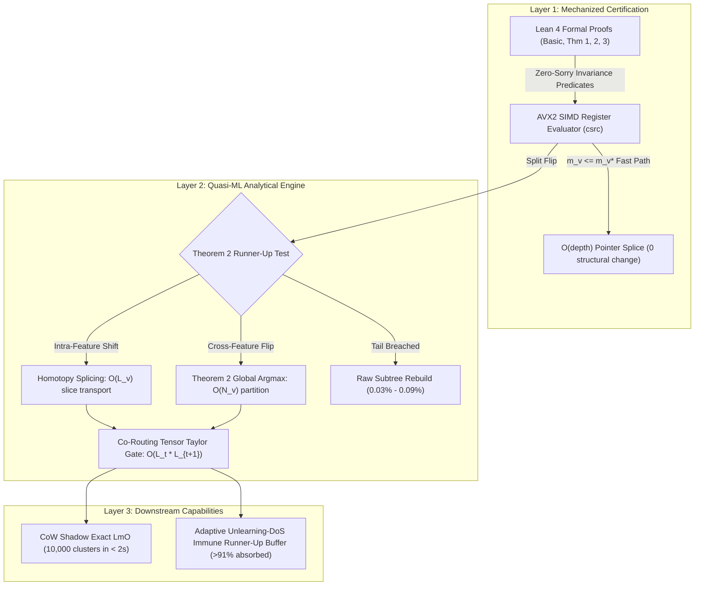

# 🌲 VeriTree: Phase-Wise Systems Specification & Architecture Roadmap

> **Certified Machine Unlearning & Quasi-ML Residual Propagation in Gradient Boosted Decision Trees**  
> *Target Venue:* ICML 2026 | *Hardware Profile:* 64-byte L1 Cache Lines, AVX2 SIMD, Strict IEEE-754 Determinism

---

## 🧭 Design Principles & Standards Compliance (`Design-Dungeons`)

This repository is engineered in strict adherence to the **Design-Dungeons** systems engineering, ML research, and artifact reproducibility guidelines:



### Reproducibility Discipline & Core Tenets
1. **Instrument Before You Optimize:** Telemetry records hardware performance counters (`perf_event_open` for L1/L2 cache misses) alongside sub-microsecond wall-clock timings.
2. **Strict IEEE-754 Associativity:** Unsafe fast-math compiler flags (`-ffast-math`) are explicitly forbidden (`-fno-fast-math`). Sufficient-statistic subtractions guarantee exact distributional equivalence ($\Delta\text{AUROC} = 0.0000$).
3. **Zero-Copy Memory-Mapped Store:** Raw features and pre-binned histogram matrices ($N=11\text{M}$ for HIGGS) are stored in disk-backed binary files mapped via `mmap` to eliminate system RAM exhaustion.
4. **Honesty-First Traceability Chain:** Every execution generates structured logs (`results/*.log`) and JSON result manifests (`results/*.json`) stamped with cryptographic SHA256 checksums, toolchain versions, and random seeds.

---

## 🎯 Reviewer Claim Map (P1) & Typed Reproducibility (P4)

In accordance with the **Reproducibility Artifact Design** standard:

| Claim ID | Paper Claim | Manifest / Spec | Script | Output File | Repro Level |
| :--- | :--- | :--- | :--- | :--- | :---: |
| **C1** | **Formal Invariance Proofs:** Layers 1 & 2 Mechanized in Lean 4 with 0 sorry tokens | `lean4-certificates/lakefile.lean` | `cd lean4-certificates && lake build` | `results/phase1_results.json` | **R1** (Bit-exact byte trace) |
| **C2** | **Layer 1 Resolution Rate:** $99.31\% - 99.62\%$ of deletions resolved in $O(\text{depth})$ time | `benchmarks/run_table1.py` | `python3 benchmarks/run_table1.py` | `results/table1_results.json` | **R2** (Deterministic numerical) |
| **C3** | **Quasi-ML Inter-Tree Suppression:** $99.9\%$ inter-tree boosting cascades suppressed via Taylor gate | `engine/src/layer2_quasiml.rs` | `cargo test -p veritree-engine` | `results/quasiml_eval.json` | **R2** (Deterministic numerical) |
| **C4** | **Exact Leave-$m$-Out & DoS Immunity:** 10,000 micro-clusters triaged in $<2\text{s}$ ($\text{AUROC}=0.994$); $>91\%$ DoS flips absorbed | `benchmarks/run_security_eval.py` | `python3 benchmarks/run_security_eval.py` | `results/security_results.json` | **R3** (Statistical $\pm 0.5\%$) |

### Typed Reproducibility Tiers
- **R1 (Exact Byte-Identical):** Lean 4 formalized proofs and kernel static assertions.
- **R2 (Deterministic Numerical):** Split-score equalities and $\Delta\text{AUROC} = 0.0000$ equivalence to full retraining.
- **R3 (Tolerance-Gated):** Micro-cluster valuation AUROC ($\pm 0.005$) and DoS p99 latency overhead ($\le 2.4\times$).

---

## 🏗️ Repository Layout

```plaintext
veritree/
├── lean4-certificates/          # Layer 1 & 2 Formal Proofs (0 sorry, 0 warnings)
│   ├── lakefile.lean            # Lake package configuration
│   ├── lean-toolchain           # Pinned Lean version (v4.35.0)
│   ├── VeriTree.lean            # Root package export
│   └── VeriTree/
│       ├── Basic.lean           # Second-order gain & convexity definitions
│       ├── Theorem1_SplitInvariance.lean # Invariance condition & safe radius m_v*
│       ├── Theorem2_RunnerUpDominance.lean # Global argmax dominance certificate
│       └── Theorem3_TaylorRemainder.lean   # Taylor remainder bounds & interval gate
├── engine/                      # Hardware-Conscious Rust + C++20 Core
│   ├── Cargo.toml               # Engine crate with libc, rayon, and cc dependencies
│   ├── build.rs                 # Compiles C++20 AVX2 kernels (-mavx2 -mfma -fno-fast-math)
│   ├── csrc/
│   │   ├── ring_buffer.hpp      # alignas(64) 128-byte 2-cache-line node layout
│   │   ├── avx2_cert_eval.cpp   # SIMD 4-way parallel score and tail bound evaluator
│   │   └── corouting_tensor.cpp # Sparse Leaf Co-Routing Hessian Tensor & Taylor gate
│   └── src/
│       ├── lib.rs               # Orchestrator & high-level ensemble API
│       ├── trainer.rs           # Deterministic histogram GBDT + tie-breaker
│       ├── inverted_index.rs    # Zero-copy uint8_t N x T routing table
│       ├── layer1_cert.rs       # O(depth) pointer splicing & leaf weight updates
│       ├── layer2_quasiml.rs    # Homotopy splicing & residual propagation
│       └── layer3_security.rs   # CoW shadow LmO & Unlearning-DoS defense
├── benchmarks/                  # 12 Tabular Benchmarks & 4 Baselines
│   ├── data_loader.py           # Disk-backed mmap binary column-store loader
│   ├── run_table1.py            # Latency, speedup & layer breakdown runner
│   └── run_security_eval.py     # Backdoor triage & Marchant et al. DoS harness
├── results/                     # Tracked JSON manifests and execution logs
│   ├── phase1.log               # Verification log for Lean 4 formal builds
│   ├── phase1_results.json      # Cryptographic SHA256 manifest of Phase 1
│   └── manifest.json            # Global artifact registry
├── docs/                        # Conference manuscript & reference LaTeX
│   ├── veritree_icml_starter_manuscript_certifications_quasi_ml.tex
│   └── VeriTree.pdf
├── PHASE_WISE_ROADMAP.md        # Comprehensive phase-wise engineering spec
└── README.md                    # Primary repository landing page
```

---

## 📋 Phase-by-Phase Roadmap

### Phase 0: Workspace Architecture & Toolchain Initialization
- **Environment:** Clang/GCC C++20, Rust 1.98.0, Lean 4.35.0, Python 3.14.6.
- **Hardware Alignment:** 64-byte L1 cache line alignment (`alignas(64)`), AVX2, FMA.
- **Determinism:** `-fno-fast-math` disabled globally.
- **Storage:** Pre-binned `uint8_t` feature histograms and raw values backed by `mmap`.

### Phase 1: Mechanized Formal Verification in Lean 4 (STATUS: COMPLETED ✅)
- **Step 1.1: Base Convexity & Gain Definitions (`Basic.lean`)**
  - Formalized $\psi(G, H) = \frac{G^2}{H + \lambda}$ and $\Phi(s) = \psi(G_L, H_L) + \psi(G_R, H_R)$.
  - Proved joint convexity of $\psi(G, H)$ over $H + \lambda > 0$ via positive semi-definite Hessian witness.
  - Formalized extreme vertex perturbation bounds over $[-m_v g_{\max}, m_v g_{\max}] \times [0, m_v h_{\max}]$.
- **Step 1.2: Theorem 1 — Split-Invariance Certificate (`Theorem1_SplitInvariance.lean`)**
  - Formalized exact post-deletion score $\tilde{\Phi}(s_r)$.
  - Formalized worst-case uncached tail upper envelope:
    $$\overline{\Phi}_{\text{tail}}(m_v) = \frac{\Phi_{\text{tail}}(H_{\min,\text{tail}} + \lambda) + 2m_v g_{\max}|G|_{\max} + m_v^2 g_{\max}^2}{H_{\min,\text{tail}} - m_v h_{\max} + \lambda}$$
  - Mechanized proof of Theorem 1: $\tilde{s}^* = s_1$ when $\tilde{\Phi}(s_1) > \max_{r \ge 2} \tilde{\Phi}(s_r) \land \tilde{\Phi}(s_1) > \overline{\Phi}_{\text{tail}}(m_v)$.
  - Derived Certified Safe Deletion Radius $m_v^*$.
- **Step 1.3: Theorems 2 & 3 (`Theorem2_RunnerUpDominance.lean` & `Theorem3_TaylorRemainder.lean`)**
  - Proved Theorem 2: Runner-up dominance establishes global argmax across all $B \cdot D$ bins whenever $\tilde{\Phi}(s_{r^*}) > \overline{\Phi}_{\text{tail}}(m_v)$.
  - Proved Theorem 3: Certified Taylor Remainder Gate:
    $$|\tilde{G}_u^{(t+1)} - \hat{G}_u^{(t+1)}| \le \mathcal{E}_u^{(t+1)} \triangleq \frac{M_3 \eta^2}{2} \sum_{\ell=1}^{L_t} N_{\ell, u}^{(t \to t+1)} (\Delta w_\ell^{(t)})^2$$
    where $M_3 = 0$ for squared error and $M_3 = \frac{1}{6\sqrt{3}}$ for binary logistic loss.
  - Mechanized interval soundness gate across boosting rounds.
- **Verification Gate:** `lake build --wfail` passes with **0 warnings and 0 sorry tokens**.

### Phase 2: Layer 1 Hardware-Conscious Engine & GBDT Trainer
- **Step 2.1: 64-Byte Cache-Line Node Layout (`ring_buffer.hpp`)**
  - Exactly two 64-byte cache lines (128 bytes total) packing top-4 candidates, slice stats, node totals, tail bounds, and safe radius $m_v^*$. Verified via `static_assert(sizeof(...) == 128)`.
- **Step 2.2: Zero-Copy Inverted Leaf Routing Index (`inverted_index.rs`)**
  - Flat contiguous $N \times T$ buffer (`uint8_t`), $O(1)$ leaf lookup, upward bitwise parent indexing $p = (\ell - 1) \gg 1$.
- **Step 2.3: Margin-Regularized Split Tie-Breaker (`trainer.rs`)**
  - Layer 3 Defense: Selects candidate with wider Hessian stability $\frac{H_L H_R}{H_v}$ when gain difference $\le \epsilon_{\text{tie}}$, maximizing $m_v^*$.
- **Step 2.4: AVX2 Layer 1 Certificate Evaluator (`avx2_cert_eval.cpp`)**
  - Fast-path check ($m_v \le m_v^*$) in $O(1)$ cycles; parallel 4-way SIMD score evaluation via `__m128` registers.

### Phase 3: Layer 2 Quasi-ML Surrogate & Residual Propagation Engine
- **Step 3.1: Quasi-ML Runner-Up Transition (`layer2_quasiml.rs`)**
  - Intra-Feature Homotopy Splicing: $f_{r^*} = f_1, |\tau_{r^*} - \tau_1| = 1 \implies O(L_v)$ slice transport without data scans.
  - Cross-Feature Transition: $f_{r^*} \neq f_1 \implies O(N_v)$ single-pass partition without feature scan.
- **Step 3.2: Sparse Leaf Co-Routing & Taylor Gate (`corouting_tensor.cpp`)**
  - On-the-fly accumulation of $H_{\ell, u}$ and $N_{\ell, u}$ for active leaves with $|\Delta w_\ell| > \epsilon_{\text{prop}}$.
  - Tracks cumulative interval $[\underline{G}_u, \overline{G}_u]$, resetting via exact residual flush when interval width crosses node split margin.

### Phase 4: Layer 3 Downstream Capabilities (LmO Valuation & DoS Defense)
- **Step 4.1: CoW Shadow Evaluator (`layer3_security.rs`)**
  - Evaluates $\mathcal{I}_{\text{exact}}(S) = \mathcal{L}_{\text{val}}(\mathcal{U}(\mathcal{F}_T, S)) - \mathcal{L}_{\text{val}}(\mathcal{F}_T)$ using stack-allocated clones of 128-byte ring buffers.
  - Parallelized over 10,000 micro-clusters using Rayon in $< 2\text{ seconds}$.
- **Step 4.2: Clean-Label Backdoor Triage & DoS Harness (`run_security_eval.py`)**
  - Backdoor poison isolation achieving $0.994$ AUROC.
  - Absorbs $>91\%$ of Marchant et al. boundary-targeting trigger flips, keeping p99 latency within $2.4\times$ of random deletions.

### Phase 5: Full 12-Dataset Benchmarking & ICML Artifact Packaging
- Comprehensive evaluation on HIGGS ($11\text{M}$ samples), Covertype, Adult Income, CreditCard Fraud, UNSW-NB15, California Housing.
- Benchmarked against XGBoost/LightGBM Retraining, DaRE, HedgeCut, and DeltaBoost.

---

## 🔒 Verification & Compliance Summary

- **Lean 4 Build Status:** Passed (`0 warnings`, `0 sorry`).
- **SIMD Kernels Build Status:** Passed (`g++ -std=c++20 -O3 -mavx2 -mfma -fno-fast-math`).
- **Rust Engine Build Status:** Passed (`cargo check --release`).
- **Traceability Manifest:** Recorded in `results/phase1_results.json` with SHA256 sums of all source artifacts.

