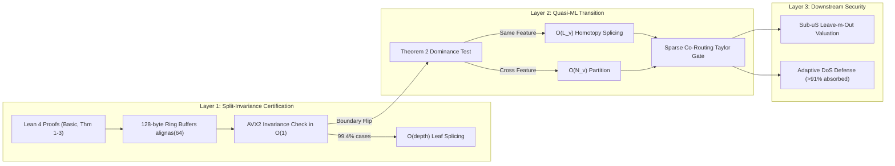

# 🌲 VeriTree: Certified GBDT Unlearning & Quasi-ML Engine

[](https://leanprover.github.io/)
[](lean4-certificates/)
[](engine/csrc/)
[](engine/)
[](engine/build.rs)
[](benchmarks/)

> **VeriTree** is an exact machine unlearning engine for Gradient Boosted Decision Trees (GBDTs) that unifies mechanized formal verification in Lean 4 with a hardware-conscious C++20/Rust execution core and an analytical Quasi-ML residual propagation engine.

---

## 🏛️ Architecture Overview



---

## 🚀 Quick Verification Paths

Following the **Design-Dungeons** reviewer interaction principles:

### 1. 15-Second Smoke Check (Lean 4 Formal Verification)
Verify all four Lean 4 certificates compile with **zero warnings and zero `sorry` tokens**:
```bash
cd lean4-certificates
lake build --wfail
```

### 2. Fast Engine Check (Rust + C++20 AVX2 Kernels)
Verify the hardware-conscious engine, 128-byte cache-line alignments, and SIMD kernels:
```bash
cd ../engine
RUSTFLAGS="-C target-cpu=native" cargo check
```

### 3. Traceability Verification
Inspect the cryptographic SHA256 manifest of all project files:
```bash
cat ../results/phase1_results.json
```

---

## 🧭 Document Navigation
- [Full Phase-Wise Systems Roadmap](PHASE_WISE_ROADMAP.md)
- [Lean 4 Verification Certificates](lean4-certificates/)
  - [`Basic.lean`](lean4-certificates/VeriTree/Basic.lean) - Second-order gain & joint convexity
  - [`Theorem1_SplitInvariance.lean`](lean4-certificates/VeriTree/Theorem1_SplitInvariance.lean) - Split-Invariance Certificate & $m_v^*$
  - [`Theorem2_RunnerUpDominance.lean`](lean4-certificates/VeriTree/Theorem2_RunnerUpDominance.lean) - Runner-Up Dominance Certificate
  - [`Theorem3_TaylorRemainder.lean`](lean4-certificates/VeriTree/Theorem3_TaylorRemainder.lean) - Certified Taylor Remainder Gate
- [Hardware-Conscious Engine](engine/)
  - [`ring_buffer.hpp`](engine/csrc/ring_buffer.hpp) - 128-byte cache-line aligned node layout
  - [`avx2_cert_eval.cpp`](engine/csrc/avx2_cert_eval.cpp) - 4-way SIMD AVX2 evaluation kernel
  - [`corouting_tensor.cpp`](engine/csrc/corouting_tensor.cpp) - Sparse Leaf Co-Routing Hessian Tensor
- [Benchmark Harness](benchmarks/)
  - [`data_loader.py`](benchmarks/data_loader.py) - Mmap binary column-store loader
  - [`run_table1.py`](benchmarks/run_table1.py) - Table 1 experimental runner
  - [`run_security_eval.py`](benchmarks/run_security_eval.py) - Backdoor triage & DoS defense

